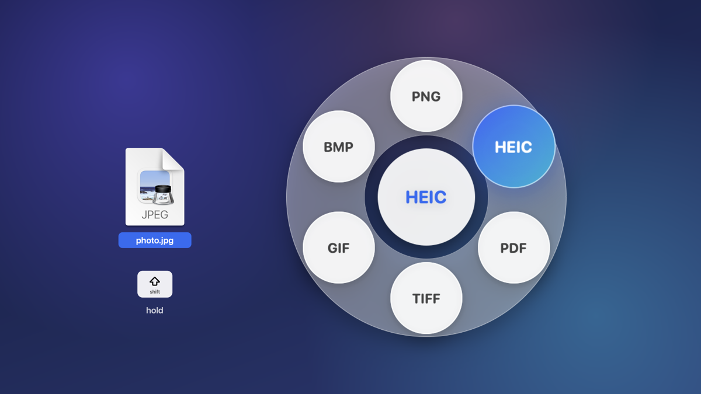
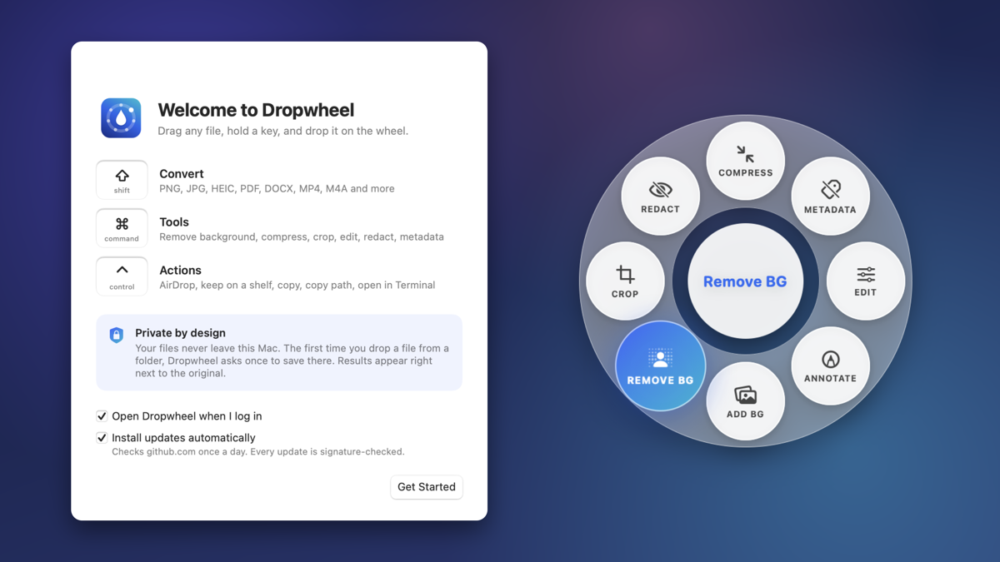
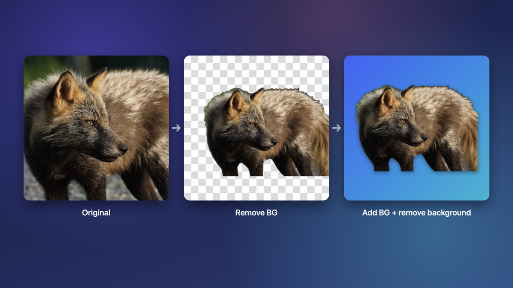

# Dropwheel

[](https://github.com/dogutez/dropwheel/actions/workflows/ci.yml)
[](https://github.com/dogutez/dropwheel/releases/latest)
[](LICENSE)


Convert and edit files by dragging them. While you drag any file, hold a key and a wheel
appears beside the cursor; drop the file on one of its drops.

## Install

**[⬇ Download Dropwheel.dmg](https://github.com/dogutez/dropwheel/releases/latest/download/Dropwheel.dmg)** (always the newest version · macOS 15 or later · Apple silicon and Intel)

1. Open **Dropwheel.dmg** and drag **Dropwheel** onto the **Applications** folder in the window.
2. Open Dropwheel from Applications.
3. The first time, macOS shows **"Dropwheel" Not Opened** (*Apple could not verify "Dropwheel" is
   free of malware…*). This is expected until releases are signed with an Apple Developer ID, and
   you only need to do this once:
   1. Click **Done** (not *Move to Trash*).
   2. Open **System Settings › Privacy & Security**.
   3. Scroll down to **Security**, find *"Dropwheel" was blocked to protect your Mac* and click
      **Open Anyway**.
   4. Enter your password or use Touch ID, then click **Open Anyway** again.

   Right-click › Open no longer skips this on macOS 15 and later. If you don't see **Open Anyway**,
   try opening Dropwheel once more, then check again.
4. On first launch, choose whether Dropwheel opens at login and installs updates automatically.
   The first time you drop a file from a folder, click **Allow** once so results can be saved
   next to your files.

## How it works





| Key | Ring | What it offers |
| --- | ---- | -------------- |
| ⇧ Shift | Convert | formats for that file type (below) |
| ⌘ Command | Tools | images: Compress, Metadata, Edit, Annotate, Add BG, Remove BG, Crop, Redact (+ Merge for several) · PDF: Compress, Metadata, Split, Merge · video: Compress, Metadata |
| ⌃ Control | Actions | AirDrop, Float (a shelf to drag from later), Copy, Copy Path, Terminal; works for any file or folder |

Press another key mid-drag to switch rings, or rest on the centre to cycle. Folders, unknown
files and mixed selections open the Actions ring.

| Dragged file | Convert to |
| ------------ | ---------- |
| Image (JPG, PNG, HEIC, WebP, AVIF, TIFF, GIF, BMP, …) | JPG, PNG, HEIC, PDF, TIFF, GIF, BMP |
| SVG | PNG, JPG, PDF (stays vector), HEIC, TIFF |
| PDF | DOCX, JPG, PNG, TXT, MD, RTF (images: one per page) |
| Text (TXT, MD, RTF, DOCX, DOC, ODT) | PDF, DOCX, TXT, MD, HTML, RTF, ODT |
| Video (MOV, MP4, M4V, …) | MP4, MOV, M4A (audio only), GIF (first 15 s) |
| Audio (MP3, M4A, WAV, AIFF, FLAC, …) | M4A, WAV, AIFF, FLAC |
| Subtitles (SRT, VTT) | SRT, VTT, TXT |
| Tables (CSV, TSV) | CSV, TSV |

Editors (Crop, Add BG, Edit, Annotate, Redact) open a window; the result is saved next to the
original as "Name cropped.jpg", "Name with background.png", and so on.

### Remove BG



Drag a photo, hold **⌘ Command** and drop it on **Remove BG**: the subject (people, animals,
objects) is lifted off its background and saved next to the original as
"Name no background.png" with a transparent background. In **Add BG**, tick *Remove the original
background* to place the subject on a new colour or gradient, with a shadow that follows its
outline.

It uses Apple's Vision model, the one behind "Lift subject" in Photos, and runs entirely on your
Mac; nothing is uploaded. It works best on photos with a clear subject. Glass, smoke and very
fine hair against a busy background can leave rough edges, and images without a subject
(screenshots, documents, landscapes) are refused with a message instead of saving an empty file.

<sub>Fox photo: U.S. Fish and Wildlife Service, Alaska Region,
[public domain](https://commons.wikimedia.org/wiki/File:Red_fox_(8385096018).jpg).</sub>

Not available, because macOS has no built-in encoder or reader and adding third-party code
would break the security model below: WebP/AVIF/MP3/OGG/Opus/WMA output, MKV/WebM/AVI input,
RAR. Not built yet: XLSX/PPTX/PAGES/EPUB, archives, audio/video Trim, Move. PDF → DOCX/TXT/MD
keeps the text only, not the layout.

Long jobs (video, audio, many PDF pages) show a progress ring in the wheel's centre; click it to
cancel. When a job finishes, the centre shows the new file's name and folder: click to reveal it
in Finder, or drag it straight out.

Requires macOS 15 or later; runs natively on Apple silicon and Intel.

## Updates

Dropwheel checks GitHub for a new version once a day and, if you allowed it, downloads and installs
it the next time you quit. Turn it off with **Install Updates Automatically** in the menu bar
icon, or check by hand with **Check for Updates…**. Builds made from source without
`release/update.env` have no updater at all.

## Build from source

Needs Xcode (or its command-line tools) with Swift 6.2.

```sh
scripts/build.sh            # build/Dropwheel.app: universal, sandboxed, hardened runtime, ad-hoc signed
scripts/build.sh --install  # also installs to ~/Applications and launches it
swift test                  # unit tests
swift run dropwheel-cli run png photo.heic   # drive the engine without the UI
```

## Releasing

```sh
cp release/update.env.example release/update.env   # set DROPWHEEL_REPO
swift scripts/update-signing.swift generate          # once; paste the printed key into update.env
scripts/release.sh 1.1.0                             # zip, Dropwheel.dmg, signature and appcast.xml in release/
git tag 1.1.0 && git push origin 1.1.0
gh release create 1.1.0 release/Dropwheel-1.1.0.zip release/Dropwheel.dmg release/appcast.xml --verify-tag
```

The signing key lives in your login Keychain ("Dropwheel update signing key"). Back it up: without
it, installed copies can't accept new versions. With an Apple Developer ID, set
`DROPWHEEL_SIGN_IDENTITY` and `DROPWHEEL_NOTARY_PROFILE` in `release/update.env` and releases are
signed and notarized too, so step 3 of Install disappears.

## Privacy and security

- **Your files never leave the Mac.** The app runs in the App Sandbox *without* the network
  entitlement, so macOS refuses every connection it might try. No analytics, no accounts.
- **Updates are the one network component, and they're isolated.** Only in release builds, and
  only if you leave "Download and install updates automatically" ticked on first launch (it is
  ticked by default; change it any time in the menu). Sparkle's separate Downloader service then
  asks github.com once a day for the release feed. That request reveals your IP address and the
  app and Sparkle versions; Sparkle's system profiling is off. Both the feed and the update are
  EdDSA-signed and checked against the key built into the app; a feed or download changed by a
  single byte is refused (tested). Sparkle's installer, by its design, runs outside the sandbox
  to replace the app. Builds without `release/update.env` contain no component that may connect.
- **No sensitive permissions.** No Accessibility, Input Monitoring or Screen Recording. Dropwheel
  listens only for global *mouse* events and reads whether ⇧ ⌘ ⌃ are held and the mouse-button
  state, never keystrokes. It reads the drag pasteboard (only file URLs, only while one of those
  keys is held mid-drag) and never reads the clipboard; Copy and Copy Path write to it when you
  choose them.
- **File access is what you hand over.** Dropwheel works only in folders you allow: the first time
  you drop a file from a folder, it asks once for that folder, and from then on it can read files
  there and save results next to them. macOS grants that as
  read *and* write access to the folder and everything inside it, so allow the folders you use,
  not your whole home folder. Without permission nothing is saved; there is no fallback location.
- **Originals are never touched.** The drop is a copy (with ⌘ or ⌃ held macOS reports it as
  "generic" or "link"), never a move. Results are written to a hidden temporary file, then
  renamed into place with `RENAME_EXCL`, so nothing is ever overwritten (`Photo.png`,
  `Photo 2.png`, …) and a half-written file is never visible. Temporary files left by a crash are
  removed on the next launch.
- **Metadata is dropped by default.** Converted and edited images keep only pixels, colour
  profile, resolution and capture time: no GPS, serial numbers, owner or computer names, IPTC or
  XMP. Videos drop location, device and title tags.
- **The Metadata tool** removes all personal metadata from photos: losslessly for JPEG; HEIC, PNG
  and TIFF are re-encoded when ImageIO can't strip them in place. The result is re-read and checked
  before it is saved (tested for every format). For PDFs it rebuilds the document without the
  document info and the XMP packet and removes comment authors (comment text stays). Every PDF
  macOS writes names macOS and its version as "Producer"; PDFKit offers no way to change that.
- **Remove BG** runs Apple's Vision model on the Mac; the photo is not sent anywhere, and the
  result carries no personal metadata (tested).
- **Redact** burns black boxes into the pixels and saves with no metadata at all. Pixelate is
  offered too but marked weaker: pixelated text can sometimes be recovered.
- **Quarantine flag.** Every file Dropwheel writes carries macOS's `com.apple.quarantine` flag (the
  sandbox adds it), so a converted file is never trusted more than a download.
- **Hostile-input limits.** Images over 250 megapixels (all frames together) are refused before
  decoding. PDF → images stops at 300 pages and 1.5 gigapixels in total. Documents over 100 MB and
  SVGs over 20 MB are refused. HTML is never imported, and document types are pinned from the
  extension, so no file can reach the WebKit importer. SVGs are drawn by AppKit, which doesn't load
  external references and rejects external XML entities and entity-expansion bombs (tested).
- **No third-party code** apart from Sparkle (updates). Everything else is Apple frameworks
  (ImageIO, PDFKit, AVFoundation, AppKit, CoreImage). File and folder names are kept out of system
  logs (errors are logged as a domain and code).
- **Signing.** Until releases are signed with an Apple Developer ID, builds are ad-hoc signed
  and carry one hardened-runtime exception (`disable-library-validation`), needed so the app can
  load its own embedded Sparkle framework. Developer ID builds don't get it.

Want to help? Read [CONTRIBUTING.md](CONTRIBUTING.md). To report a security problem, see
[SECURITY.md](SECURITY.md). MIT licensed, see [LICENSE](LICENSE).
